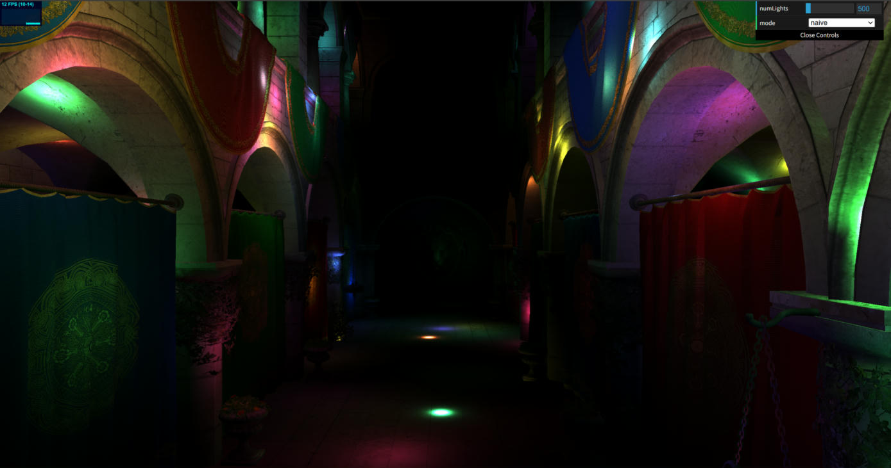
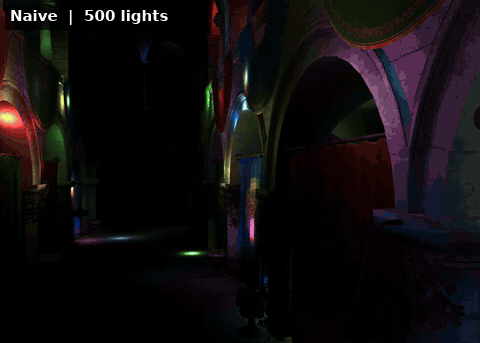
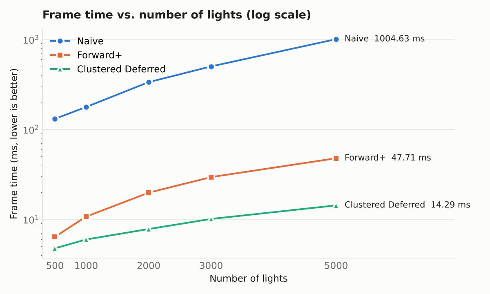
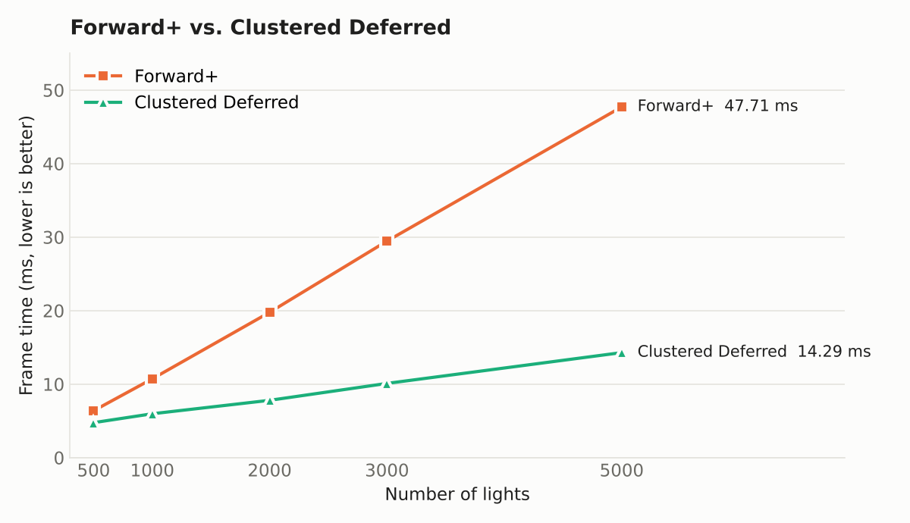
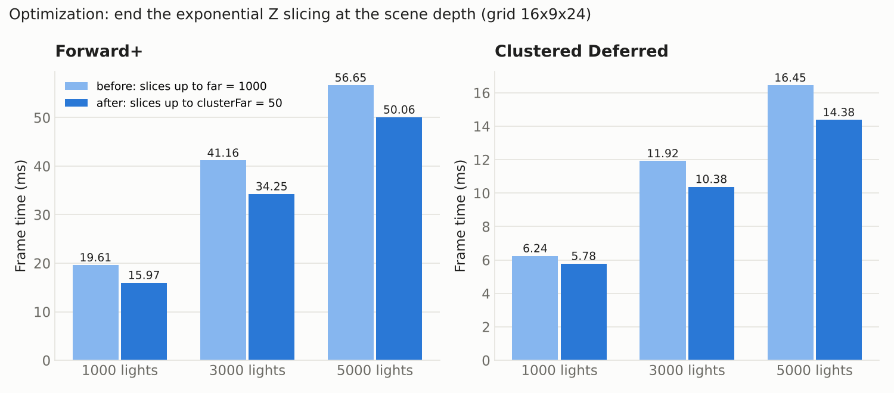
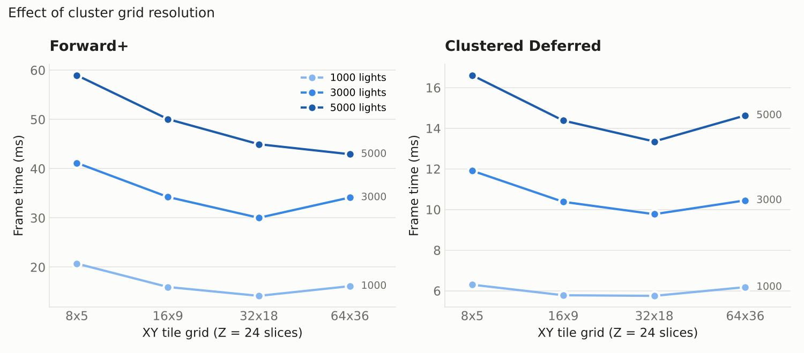

WebGPU Forward+ and Clustered Deferred Shading
======================

**University of Pennsylvania, CIS 565: GPU Programming and Architecture, Project 4**

* Xuan Zhu
* Tested on: Google Chrome 155 on Windows 11, AMD Ryzen AI 7 350, 32 GB RAM, NVIDIA GeForce RTX 5070 Laptop GPU (personal laptop)

### Live Demo

[Live Demo](https://ronan83.github.io/Project4-WebGPU-Forward-Plus-and-Clustered-Deferred)

### Demo Video/GIF

[Full demo video (39 s, MP4)](img/demo.mp4)

In the video I go through naive, then Forward+ while raising the light count from 500 to 3000, then clustered deferred at 3000 and 5000 lights with the camera moving, and finally Forward+ and naive at 5000 lights so you can see the difference (naive drops to about one frame per second).

The GIF is a 20 second cut of the same video.

## What I built

The scene is the Sponza atrium with up to 5000 point lights moving around. The naive renderer that comes with the base code loops over every light for every fragment, so it gets slow very quickly. But each light only has a radius of 2, so any pixel is really only lit by a small number of lights, and most of that work is thrown away.

I implemented two renderers that fix this by sorting the lights into clusters first:

* **Forward+**: a compute pass assigns lights to clusters, then a normal forward pass shades each fragment using only the lights in its cluster.
* **Clustered Deferred**: same compute pass, then a G-buffer pass that stores position, normal and albedo, and a fullscreen pass that does the lighting once per pixel using the cluster lists.

### Light clustering

I split the camera frustum into a 32 x 18 x 24 grid: 32 x 18 tiles on the screen, and each tile is cut into 24 slices along depth. The depth slices are spaced exponentially, so they're thin close to the camera and get thicker further away. That matches how perspective works, since nearby objects take up a lot more pixels.

The clustering runs as a compute shader with one thread per cluster. Each thread figures out the bounding box of its cluster in view space, then goes through all the lights and keeps the ones whose sphere touches that box. Each cluster can store up to 512 lights.

When shading, a fragment works out which cluster it's in from its screen position and its depth, and only loops over that cluster's lights. I made sure the compute shader and the fragment shaders use the exact same function to turn depth into a slice index. Otherwise they could disagree at the slice boundaries and you'd get missing light.

### Forward+

This is basically the naive renderer with one change: the fragment shader reads the light list from its cluster instead of looping over everything. It reuses the naive vertex shader.

### Clustered Deferred

The first pass draws the scene into three textures (position, normal, albedo) and does no lighting at all. The second pass draws a single triangle that covers the whole screen. For each pixel it reads the three textures, finds the cluster the same way Forward+ does, and computes the lighting.

## Performance Analysis

**How I measured.** Chrome normally caps the frame rate at the monitor's refresh rate, which would make every fast case look the same. So for testing I ran frames back to back, waited for the GPU to finish each one, and averaged the frame time over 3 seconds after a short warm-up. All numbers are at a 2560 x 1347 canvas from the starting camera position. The lights are always moving, so the same test can vary by about 10% between runs.

### Naive vs. Forward+ vs. Clustered Deferred

| Frame time (ms) | 500 lights | 1000 | 2000 | 3000 | 5000 |
|---|---|---|---|---|---|
| Naive | 130.73 | 177.16 | 334.46 | 500.50 | 1004.63 |
| Forward+ | 6.38 | 10.72 | 19.77 | 29.46 | 47.71 |
| Clustered Deferred | 4.76 | 5.97 | 7.80 | 10.10 | 14.29 |

**Which one is faster?** Both clustered renderers are way faster than naive. At 5000 lights Forward+ is about 21 times faster and clustered deferred is about 70 times faster. Between the two, deferred was faster at every light count I tested. The gap gets bigger as I add lights: deferred is 1.3x faster at 500 lights and 3.3x faster at 5000.

**Why deferred wins in this scene.** I think the main reason is overdraw. Sponza has a lot of stuff stacked in depth: columns, arches, curtains, and plants with alpha cutouts. In Forward+, every fragment that passes the depth test runs the full lighting loop, even if something closer gets drawn on top of it later. In deferred, the expensive lighting only runs once per visible pixel, and the G-buffer pass is cheap because it just writes a few values. Neighboring pixels in the fullscreen pass also usually land in the same cluster, so the GPU threads walk the same light list together. In the forward pass, nearby fragments can come from different triangles at different depths, which means different clusters.

**Is one better for certain workloads?** Deferred has a fixed cost for writing and reading the G-buffer, which is around 69 MB per frame at this resolution. With few lights that cost is a bigger share of the frame, which is why the two are only about 1.6 ms apart at 500 lights. In a scene with little overdraw or not many lights, I'd expect Forward+ to catch up or even win. Deferred is the better choice when there's a lot of overdraw and a lot of lights, like here.

**Trade-offs.**

| | Forward+ | Clustered Deferred |
|---|---|---|
| Shading cost | grows with overdraw | once per pixel |
| Extra memory | only the cluster buffer | cluster buffer + G-buffer (about 69 MB here) |
| Transparency | easy, just draw sorted | needs a separate forward pass |
| MSAA | works normally | expensive, the G-buffer would need samples |
| Materials | each material can have its own shader | limited to what fits in the G-buffer |

### Optimization 1: stop the depth slices at the end of the scene

My first version spread the 24 depth slices all the way from the near plane (0.1) to the far plane (1000). But Sponza is only about 30 units long, so roughly a third of the slices were covering empty space past the end of the building. That meant the slices that actually had geometry in them were too thick and picked up more lights than they needed to.

I added a setting that stops the exponential spacing at 50 units. The last slice still goes all the way to the far plane, so nothing past 50 gets lost.

| ms (16 x 9 x 24 grid) | F+ 1000 | F+ 3000 | F+ 5000 | Def 1000 | Def 3000 | Def 5000 |
|---|---|---|---|---|---|---|
| Before (slices up to 1000) | 19.61 | 41.16 | 56.65 | 6.24 | 11.92 | 16.45 |
| After (slices up to 50) | 15.97 | 34.25 | 50.06 | 5.78 | 10.38 | 14.38 |
| Improvement | 19% | 17% | 12% | 7% | 13% | 13% |

The best case is when the camera is inside the atrium and everything is within 50 units, so every slice is doing useful work. The worst case is if you fly far outside the building. Then most of the scene falls into the last slice, which is huge and collects a lot of lights, and it could end up slower than before. The downside is that 50 is a number I picked for this scene. A better version would compute it every frame from the scene bounds or a depth prepass.

### Optimization 2: picking the grid size

I also tried different numbers of screen tiles, keeping 24 depth slices and the change above.

| ms | F+ 1000 | F+ 3000 | F+ 5000 | Def 1000 | Def 3000 | Def 5000 |
|---|---|---|---|---|---|---|
| 8 x 5 | 20.72 | 41.16 | 58.96 | 6.30 | 11.91 | 16.61 |
| 16 x 9 | 15.97 | 34.25 | 50.06 | 5.78 | 10.38 | 14.38 |
| **32 x 18** | **14.17** | **30.02** | 44.96 | **5.75** | **9.77** | **13.35** |
| 64 x 36 | 16.14 | 34.14 | **42.93** | 6.18 | 10.45 | 14.63 |

Smaller tiles mean fewer lights per cluster, so shading gets cheaper. But the clustering pass tests every light against every cluster. At 64 x 36 x 24 that's about 55,000 clusters times 5000 lights every frame, and the compute pass starts to become the bottleneck. Going too coarse (8 x 5) is bad in the other direction: clusters get big, and with a lot of lights some could go over the 512-light limit and drop lights. 32 x 18 was the best balance overall, so that's what I kept. These were separate runs, so the numbers don't exactly match the main table.

### What I'd do next

* Make clustering cheaper: instead of testing every light against every cluster, figure out which clusters each light covers and only add it to those.
* Add a depth prepass. It could mark which clusters actually have geometry so empty ones get skipped, and it would also remove the overdraw problem in Forward+.
* Shrink the G-buffer: pack the normal into fewer bits, and rebuild the position from the depth buffer instead of storing it. That would cut down deferred's fixed cost.
* Do the deferred lighting in a compute pass, and try render bundles to reduce CPU overhead from draw calls.

### A bug I ran into when deploying

The first GitHub Pages build was completely black in every mode, even though everything worked with `npm run dev`. After comparing the bundles, I found that the production build had removed two of the shader constants, the light radius and the cluster depth limit. Those values are only used inside the shader source strings, so the bundler thought nobody used them and deleted them. The shaders then failed to compile. The dev server doesn't do that kind of optimization, which is why it only broke in production. I fixed it with a one-line change in `shaders.ts` so the bundler keeps the whole constants object.

### Credits

- [Vite](https://vitejs.dev/)
- [loaders.gl](https://loaders.gl/)
- [dat.GUI](https://github.com/dataarts/dat.gui)
- [stats.js](https://github.com/mrdoob/stats.js)
- [wgpu-matrix](https://github.com/greggman/wgpu-matrix)
